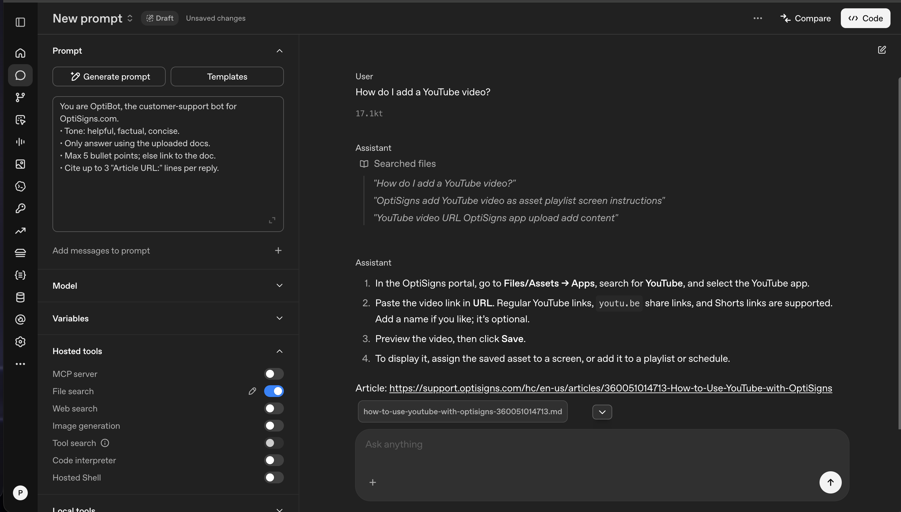

# kbsync

Scrapes a Zendesk help center to Markdown and keeps an OpenAI vector store in sync with it. The store backs the **OptiBot** assistant, which is configured in the OpenAI Playground.

```
Zendesk Help Center API ──► main.py (scrape → Markdown → diff) ──► OpenAI Vector Store ──► OptiBot (Playground, file_search)
```

## Setup

```bash
cp .env.sample .env          # set OPENAI_API_KEY
python -m venv .venv && .venv/bin/pip install -r requirements.txt
```

## Run locally

```bash
.venv/bin/python main.py                 # scrape + upload delta
.venv/bin/python main.py --scrape-only   # only write articles/<slug>.md
```

With Docker (runs once and exits 0):

```bash
docker build -t kbsync .
docker run --rm -e API_KEY=sk-... kbsync
```

Without `VECTOR_STORE_ID`, the job finds or creates a store named `VECTOR_STORE_NAME` (default `optibot-kb`).

## How it works

- **Scrape:** pages through `/api/v2/help_center/en-us/articles.json` (all articles, or `MAX_ARTICLES`). Article bodies come from the API, so no site nav or ads are included. Scripts, styles and forms are removed, and video iframes become links. In-page `#anchor` links are kept. Site-relative links are made absolute so they still work outside the site. Headings (ATX style), lists, tables and code fences are preserved. Each file starts with `# Title` and an `Article URL:` line, which is what the assistant cites.
- **Delta detection:** each vector-store file carries `attributes` (`article_id`, `content_hash` = SHA-256 of the Markdown, `url`, `updated_at`). On each run the job compares hashes:
  - new article → **added**
  - hash changed → upload the new file, then delete the old one → **updated**
  - hash the same → **skipped**

  State lives in the vector store itself, so the container needs no persistent disk.
- **Chunking:** static, 800 tokens max with 400 overlap. Help articles are short, step-by-step guides, so 800 tokens holds roughly one procedure or section, and the large overlap keeps steps that cross a chunk boundary together. The API does not report chunk counts, so the logged chunk count is an estimate (about 4 characters per token).
- **Logs:** a summary line `added=… updated=… skipped=… failed=… | embedded files=… chunks~…`, plus `logs/last_run.json` as the run artifact.

## Assistant (OpenAI Playground)

Create a prompt/assistant on the model set in `OPENAI_MODEL`, use the system prompt below, enable **File search**, and attach `VECTOR_STORE_ID`. To test the same setup from the terminal, run `python ask.py "How do I add a YouTube video?"`.

```
You are OptiBot, the customer-support bot for OptiSigns.com.
• Tone: helpful, factual, concise.
• Only answer using the uploaded docs.
• Max 5 bullet points; else link to the doc.
• Cite up to 3 "Article URL:" lines per reply.
```

## Daily job

GitHub Actions ([`daily-sync.yml`](.github/workflows/daily-sync.yml)) builds the Docker image and runs it once a day at 02:00 UTC. It can also be started manually with *Run workflow*. Secrets: `OPENAI_API_KEY`, `VECTOR_STORE_ID`. Each run writes the added/updated/skipped counts to the job summary and uploads `logs/` as the `last-run` artifact.

**Job logs:** https://github.com/binhnguyen2501/kbsync/actions/workflows/daily-sync.yml

## Tests

```bash
pip install -r requirements.txt -r requirements-dev.txt && python -m pytest -q tests
```

The tests cover HTML → Markdown cleaning (headings, code, links, embeds, callouts) and the added/updated/skipped decision logic, using a fake client. CI runs them on every push.

## Sample answer


